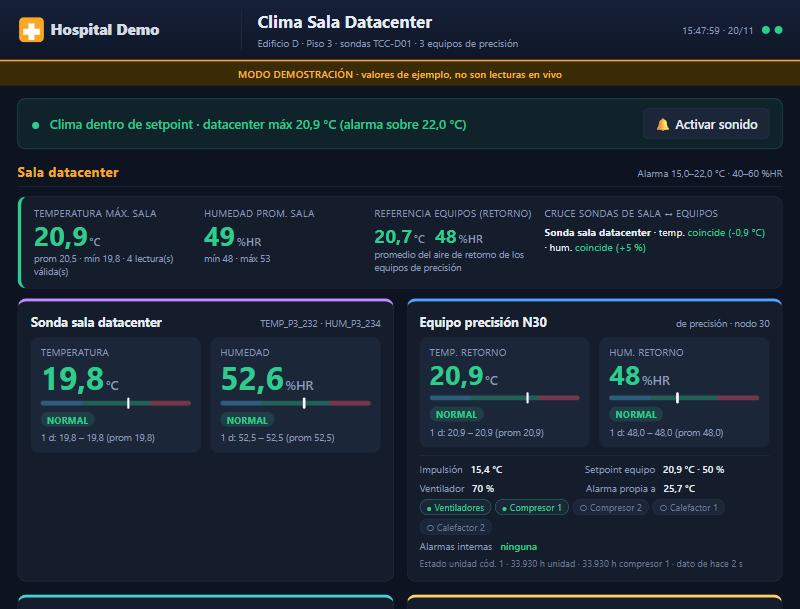

# Datacenter Climate Monitor

**Read-only temperature and humidity monitor for a datacenter and an electrical room. It reads BACnet/IP room probes and precision air-conditioning units through a FieldServer gateway, cross-checks them, and raises alarms with delay and hysteresis.**



> 🇪🇸 Versión **anonimizada** de un sistema que hice y que funciona en un hospital público de Chile. Los nombres, las IP, la MAC y los datos del recinto se reemplazaron; las IP usan el rango de documentación `192.0.2.0/24` (RFC 5737). Los valores de la demo son de ejemplo.

## Qué resuelve

Si el datacenter de un hospital se calienta, la caída de los servidores afecta a la ficha clínica, al laboratorio y a la imagenología. Este dashboard:

- Lee las **sondas de sala** por BACnet/IP y los **3 equipos de precisión** por la JSON-RPC de un FieldServer (gateway Modbus).
- **Cruza las fuentes**: si una sonda de sala se aleja más de 2 °C o 10 %HR del aire de retorno de los equipos, lo marca como *discrepancia*. Así se detecta una sonda descalibrada antes de que falle una alarma.
- Usa **alarmas por zona** con retardo de 60 s e histéresis, y trata las lecturas fuera de 10–50 °C o 15–95 %HR como *falla de sensor*.
- Permite editar los setpoints desde el dashboard, protegidos con una clave obligatoria si se publica en la red.
- Guarda 2 años de historial en SQLite y exporta a Excel, con un tope de filas para no congelar el PC.

## Seguridad: auditoría incluida

[`docs/AUDITORIA_2026-09-29.md`](docs/AUDITORIA_2026-09-29.md) documenta 18 hallazgos con su corrección y su prueba. Entre ellos:

- **Instancia única real en Windows** (`SO_EXCLUSIVEADDRUSE`): `SO_REUSEADDR` dejaba que dos monitores escribieran la misma base.
- **CSRF y DNS rebinding**: los POST exigen `application/json` y un `Origin` igual al `Host`, y con escucha local solo se aceptan hosts locales.
- **Lista blanca de métodos del FieldServer**: su interfaz no tiene autenticación y permite reconfigurarlo, así que el cliente rechaza cualquier método que no sea de lectura antes de salir a la red.
- **Sin IPs ni MAC** en la API, la interfaz ni el Excel. Solo quedan en la configuración y el log local.
- CSP y cabeceras de seguridad, y comparación de claves en tiempo constante (`hmac.compare_digest`).

## Cómo está hecho

| Parte | Detalle |
|---|---|
| Protocolos | BACnet/IP sobre UDP crudo y JSON-RPC del FieldServer, ambos solo con la biblioteca estándar |
| Lógica | `alarmas.py`: clasificación, retardo, histéresis y validación, sin E/S y fácil de probar |
| Servidor | `ThreadingHTTPServer` con protecciones propias, sin framework |
| Frontend | HTML + JS sin CDN, con alarma sonora opcional |
| Pruebas | **36 pruebas** sin red: 16 de seguridad y 3 de regresión del cliente BACnet |

## Probarlo

Requiere Python 3.8 o superior. No hay que instalar paquetes.

```bash
python -m clima --demo
```

Se abre en <http://localhost:8090>. El modo demo no abre sockets hacia ningún equipo.

```bash
python -m unittest discover tests
```

## Licencia

MIT. `vendor/` contiene openpyxl y et_xmlfile con sus propias licencias (MIT).
